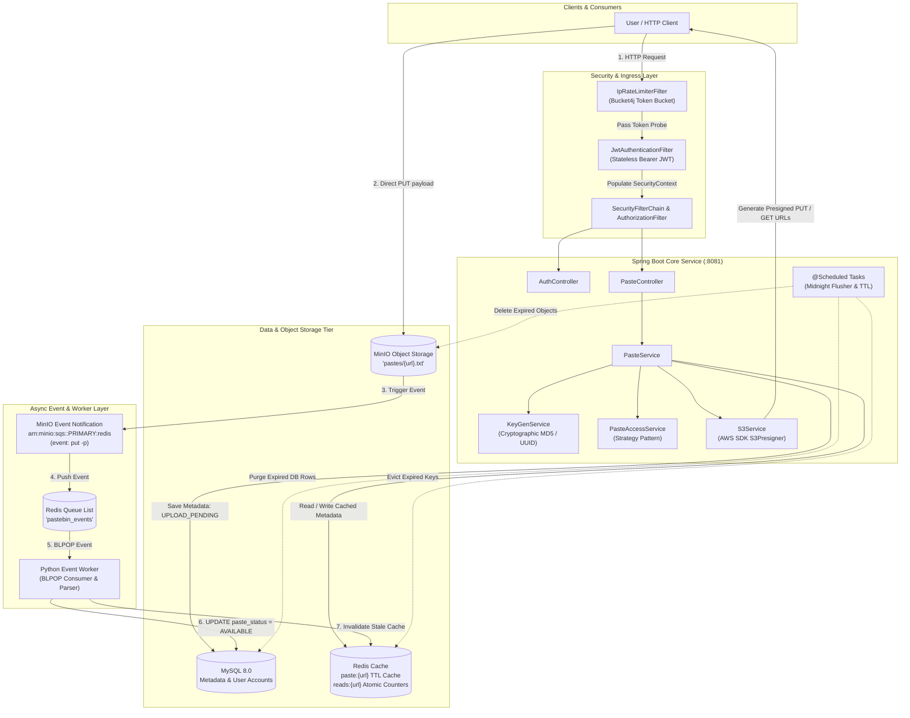
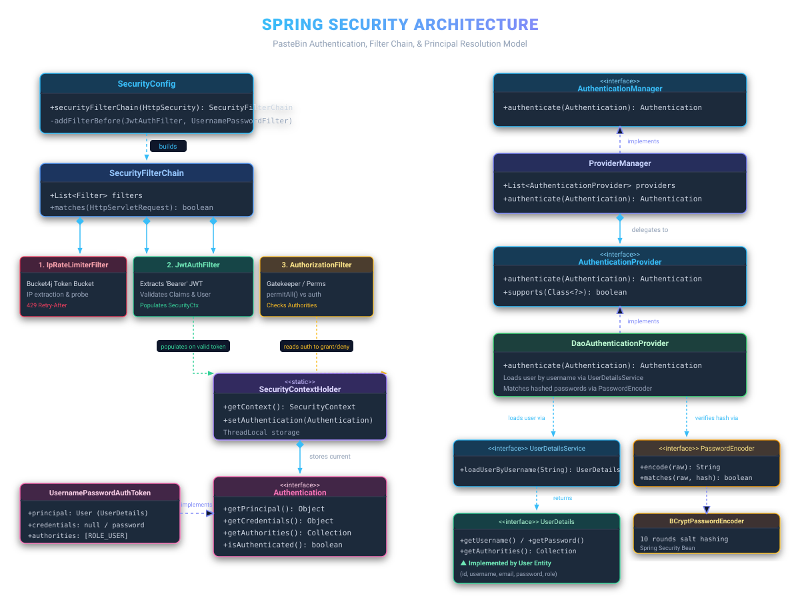
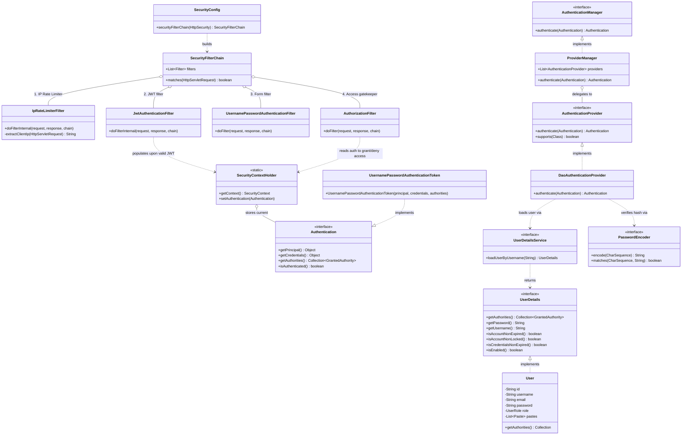
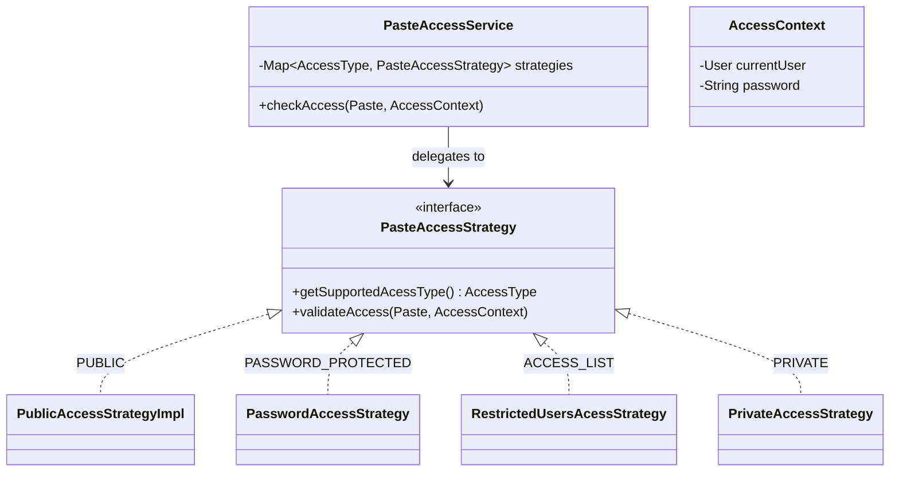
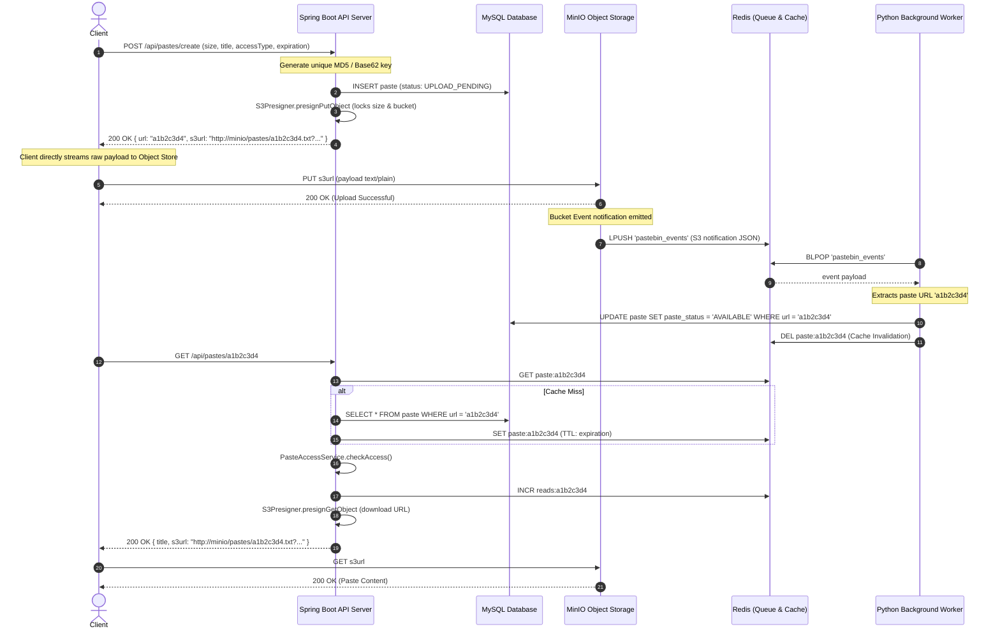

# 📋 Distributed Scalable PasteBin System

[](https://openjdk.org/)
[](https://spring.io/projects/spring-boot)
[](https://spring.io/projects/spring-security)
[](https://www.mysql.com/)
[](https://redis.io/)
[](https://min.io/)
[](https://bucket4j.com/)
[](https://www.docker.com/)

A high-performance, enterprise-grade, distributed **PasteBin system design** implementation built with **Spring Boot 4**, **MySQL**, **Redis**, **MinIO (S3-compatible Object Storage)**, and an isolated **Event-Driven Python Worker**.

Engineered around distributed systems best practices, this architecture completely decouples payload transport from the application server using **direct-to-S3 presigned URLs**, eliminates memory bloat, ensures non-blocking upload verifications via an **asynchronous Redis event queue**, and protects all public endpoints with **Bucket4j token-bucket IP rate limiting** and stateless **JWT authentication**.

---

## 📑 Table of Contents

- [System Architecture Overview](#-system-architecture-overview)
- [Spring Security Architecture & Class Diagram](#-spring-security-architecture--class-diagram)
- [Key Architectural Highlights & Design Patterns](#-key-architectural-highlights--design-patterns)
  - [1. Direct-to-S3 Upload (Zero App-Server Ingestion Overhead)](#1-direct-to-s3-upload-zero-app-server-ingestion-overhead)
  - [2. Event-Driven Asynchronous Status Reconciliation](#2-event-driven-asynchronous-status-reconciliation)
  - [3. Granular Access Control via Strategy Pattern](#3-granular-access-control-via-strategy-pattern)
  - [4. Multi-Layer Caching & Read Counter Decoupling](#4-multi-layer-caching--read-counter-decoupling)
  - [5. Token Bucket IP Rate Limiting](#5-token-bucket-ip-rate-limiting)
  - [6. Automated Cron Lifecycle Management](#6-automated-cron-lifecycle-management)
- [Direct-to-S3 Ingestion & Verification Sequence Flow](#-direct-to-s3-ingestion--verification-sequence-flow)
- [Repository Structure](#-repository-structure)
- [Technology Stack](#-technology-stack)
- [Environment Configuration](#-environment-configuration)
- [Getting Started](#-getting-started)
  - [Prerequisites](#prerequisites)
  - [Running the Infrastructure](#1-start-backing-services-via-docker-compose)
  - [Running the Spring Boot Application](#2-run-the-spring-boot-application)
- [API Reference & Usage Examples](#-api-reference--usage-examples)
  - [Authentication API](#1-authentication-endpoints)
  - [Pastes API](#2-pastes-endpoints)
- [Error Handling & HTTP Status Codes](#-error-handling--http-status-codes)
- [Architecture Diagrams & Excalidraw Assets](#-architecture-diagrams--excalidraw-assets)

---

## 🏛 System Architecture Overview

The system architecture prevents application server starvation by offloading heavy raw paste uploads and downloads directly to MinIO Object Storage, backed by asynchronous queue reconciliation and low-latency cache reads:



---

## 🔐 Spring Security Architecture & Class Diagram

The application implements a stateless **Spring Security 6+** filter pipeline. Below is the complete class diagram matching the design in [docs/diagrams/spring-security-architecture.svg](docs/diagrams/spring-security-architecture.svg) and [docs/diagrams/spring-security-architecture.excalidraw](docs/diagrams/spring-security-architecture.excalidraw):

<p align="center">
  
</p>

### Interactive Security Class Diagram (Mermaid)



### Security Pipeline Workflow:
1. **`IpRateLimiterFilter`**: Extracts IP from `X-Forwarded-For` or `RemoteAddr`. Probes Bucket4j bucket. Returns `429 Too Many Requests` with `Retry-After` if exhausted.
2. **`JwtAuthenticationFilter`**: Inspects `Authorization: Bearer <token>`. Decodes claims using `JwtService`. Validates expiration and user identity against `UserDetailsService`.
3. **`SecurityContextHolder`**: If token is valid, creates a `UsernamePasswordAuthenticationToken` and sets it in the thread-local context.
4. **`AuthorizationFilter`**: Validates whether the matched request path permits anonymous access (`/api/auth/**`, `GET /api/pastes/**`) or requires an authenticated principal.
5. **`DaoAuthenticationProvider` & `PasswordEncoder`**: Used during login (`POST /api/auth/login`) to verify credentials against BCrypt salted password hashes.

---

## 🚀 Key Architectural Highlights & Design Patterns

### 1. Direct-to-S3 Upload (Zero App-Server Ingestion Overhead)
Traditional paste systems stream megabytes of payload through the application server heap. This project uses AWS S3 Presigned URLs (`S3Presigner`):
- When a paste is registered, the server reserves a unique short URL and returns a **Presigned PUT S3 URL** valid for a strictly locked duration (`minio.presign-duration=75` minutes).
- **Exact Size Enforcement**: The presigned URL locks `contentLength(lockedSize)` and `contentType("text/plain")`. Any client attempting to upload larger payloads is immediately rejected by S3.
- Application servers stay completely lightweight with negligible CPU and memory consumption.

### 2. Event-Driven Asynchronous Status Reconciliation
- Pastes are initialized in MySQL with `pasteStatus = UPLOAD_PENDING`.
- Once the client uploads the raw bytes to MinIO, MinIO automatically emits a notification to the Redis list `pastebin_events`.
- A lightweight, containerized Python worker consumes events via `BLPOP` without public ingress:
  ```sql
  UPDATE paste 
  SET paste_status = 'AVAILABLE' 
  WHERE url = %s AND paste_status = 'UPLOAD_PENDING';
  ```
- The worker evicts any cached entry (`paste:{url}`) to guarantee strong read consistency across all application instances.

### 3. Granular Access Control via Strategy Pattern
Paste security is decoupled using the **Strategy Design Pattern**:

- **`PUBLIC`**: Unrestricted worldwide read access.
- **`PASSWORD_PROTECTED`**: Validates supplied plaintext password against BCrypt hash; throws `PasswordRequiredException` (HTTP 401) or `UnauthorizedException` (HTTP 403).
- **`ACCESS_LIST`**: Authorizes only usernames explicitly declared in the paste's `authorizedUsers` set (or the original creator).
- **`PRIVATE`**: Strict creator-only access via `@AuthenticationPrincipal User`.

### 4. Multi-Layer Caching & Read Counter Decoupling
- **Read-Through Cache**: When a paste is requested, `PasteService` checks `paste:{url}` in Redis. On cache hit, metadata deserializes instantly from `PasteCacheDto` without touching MySQL.
- **Dynamic TTL**: Cached entries have their expiration dynamically aligned with the paste's remaining lifespan.
- **Decoupled Analytics**: Read views are incremented via atomic Redis commands (`INCR reads:{url}`), avoiding row-level write contention in the relational database.

### 5. Token Bucket IP Rate Limiting
- Built on **Bucket4j**: Configured with a default capacity of **5 requests per 30-second window** per unique IP.
- Correctly parses the real client IP through reverse proxies by inspecting the leftmost entry in `X-Forwarded-For`.
- Responds with standard `Retry-After: <seconds>` headers on limit breaches.

### 6. Automated Cron Lifecycle Management
Integrated Spring `@Scheduled` tasks run unattended maintenance:
- **Midnight Object Flush (`flushExpiredPastes`)**: Queries expired pastes, issues S3 `DeleteObjectRequest` to MinIO, and purges Redis keys.
- **Pending Paste Reaper (`expireObsoletePastes`)**: Reclaims abandoned paste reservations left in `UPLOAD_PENDING` for more than 5 minutes.

---

## 🔄 Direct-to-S3 Ingestion & Verification Sequence Flow



---

## 📂 Repository Structure

```text
PasteBin/
├── .env.example                               # Infrastructure environment template
├── docker-compose.yml                         # Containerized MySQL, Redis, MinIO, mc, & Worker
├── pom.xml                                    # Spring Boot 4.1.1 + AWS SDK + Bucket4j + JJWT
├── mvnw / mvnw.cmd                            # Maven Wrapper
├── docs/
│   └── diagrams/
│       ├── spring-security-architecture.svg   # High-resolution SVG Security Architecture
│       └── spring-security-architecture.excalidraw # Native editable Excalidraw JSON scene
├── worker/
│   ├── Dockerfile                             # Minimal Python 3.10 slim container
│   ├── requirements.txt                       # redis, pymysql dependencies
│   └── worker.py                              # Redis event listener & DB status updater
└── src/
    ├── main/
    │   ├── java/com/example/pastebin/
    │   │   ├── Controller/
    │   │   │   ├── AuthController.java        # Authentication endpoints (register, login, me)
    │   │   │   └── PasteController.java       # Paste CRUD & retrieval endpoints
    │   │   ├── Dto/                           # Request & Response payload definitions
    │   │   ├── Entity/
    │   │   │   ├── Paste.java                 # JPA Entity (title, url, status, accessType)
    │   │   │   └── User.java                  # JPA Entity + Spring Security UserDetails
    │   │   ├── Enum/                          # AccessType, PasteStatus, UserRole
    │   │   ├── Exception/                     # Exception definitions & @RestControllerAdvice
    │   │   ├── repository/                    # Spring Data JPA repositories
    │   │   ├── security/
    │   │   │   ├── ApplicationConfig.java     # DaoAuthProvider, UserDetailsService, BCrypt
    │   │   │   ├── IpRateLimiterFilter.java   # Bucket4j IP Rate Limiting filter
    │   │   │   ├── JwtAuthenticationFilter.java # Stateless Bearer JWT extraction filter
    │   │   │   └── SecurityConfig.java        # SecurityFilterChain pipeline definition
    │   │   ├── Service/
    │   │   │   ├── impl/                      # Paste Access Strategy implementations
    │   │   │   ├── AuthenticationService.java # User registration & JWT badge issuance
    │   │   │   ├── JwtService.java            # HMAC-SHA token generator & claim verifier
    │   │   │   ├── KeyGenService.java         # Secure Random MD5 short-hash generator
    │   │   │   ├── PasteAccessService.java    # Strategy dispatcher
    │   │   │   ├── PasteService.java          # Core paste workflow, cache, and scheduler
    │   │   │   ├── RateLimitingService.java   # Token bucket manager
    │   │   │   └── S3Service.java             # MinIO / AWS S3 presigner & cron flusher
    │   │   └── PasteBinApplication.java       # Spring Boot main entrypoint (@EnableScheduling)
    │   └── resources/
    │       └── application.properties         # Server port, datasource, MinIO & JWT configs
    └── test/
```

---

## 🛠 Technology Stack

| Layer | Component | Description |
|---|---|---|
| **Language & Framework** | Java 17, Spring Boot 4.1.1 | Modern Spring Boot enterprise foundation |
| **Security & Auth** | Spring Security 6, JJWT 0.12.6, BCrypt | Stateless JWT Bearer tokens + salted password hashing |
| **Rate Limiting** | Bucket4j JDK 17 (8.21.0) | Token-bucket rate limiter with `X-Forwarded-For` support |
| **Relational Database** | MySQL 8.0, Spring Data JPA / Hibernate | Persistent storage for users, metadata, and access lists |
| **In-Memory Cache & Queue**| Redis (Alpine), Spring Data Redis | Sub-millisecond metadata caching & BLPOP event bus |
| **Object Storage** | MinIO (AWS S3 SDK 2.55.12) | High-throughput object storage for raw paste files |
| **Event Worker** | Python 3.10, PyMySQL, redis-py | Zero-ingress async consumer updating paste statuses |
| **Infrastructure** | Docker & Docker Compose | Containerized orchestration for all backing services |

---

## ⚙ Environment Configuration

Copy `.env.example` to `.env` before running Docker Compose:

```bash
cp .env.example .env
```

| Variable | Default Value | Description |
|---|---|---|
| `MYSQL_HOST` | `mysql` (Docker) / `localhost` | MySQL hostname |
| `MYSQL_PORT` | `3306` | MySQL port |
| `MYSQL_ROOT_PASSWORD` | `root` | Root password for MySQL |
| `MYSQL_DATABASE` | `pastebin` | Application database schema name |
| `REDIS_HOST` | `redis` (Docker) / `localhost` | Redis hostname |
| `REDIS_PORT` | `6379` | Redis port |
| `REDIS_EVENTS_QUEUE` | `pastebin_events` | Redis list key for MinIO S3 notifications |
| `MINIO_HOST` | `minio` (Docker) / `localhost` | MinIO API host |
| `MINIO_PORT` | `9000` | MinIO S3 API port |
| `MINIO_CONSOLE_PORT` | `9001` | MinIO Web UI Console port |
| `MINIO_ROOT_USER` | `minioadmin` | MinIO root access key |
| `MINIO_ROOT_PASSWORD` | `minioadmin` | MinIO root secret key |
| `MINIO_BUCKET_NAME` | `pastebin` | Target S3 bucket for paste storage |

---

## 🚦 Getting Started

### Prerequisites
- [Docker Engine & Docker Compose](https://docs.docker.com/get-docker/)
- [Java Development Kit (JDK) 17+](https://adoptium.net/)

### 1. Start Backing Services via Docker Compose

Launch MySQL, Redis, MinIO, the auto-bucket initializer, and the background worker:

```bash
docker compose up -d --build
```

Verify all containers are healthy:
```bash
docker compose ps
```

*Expected output:*
- `pastebin-mysql`: Up on port `3306`
- `pastebin-redis`: Up on port `6379`
- `pastebin-minio`: Up on ports `9000` (API) and `9001` (Console)
- `pastebin-worker`: Up (Listening for Redis events)

### 2. Run the Spring Boot Application

Using the included Maven wrapper:

**On Linux / macOS:**
```bash
./mvnw clean spring-boot:run
```

**On Windows:**
```powershell
.\mvnw.cmd clean spring-boot:run
```

The application starts on `http://localhost:8081`.

---

## 📡 API Reference & Usage Examples

### 1. Authentication Endpoints

#### Register a New User
```bash
curl -X POST http://localhost:8081/api/auth/register \
  -H "Content-Type: application/json" \
  -d '{
    "username": "alex",
    "email": "alex@example.com",
    "password": "Password123!"
  }'
```
*Response (200 OK):*
```json
{
  "token": "eyJhbGciOiJIUzI1NiIsInR5cCI6IkpXVCJ9..."
}
```

#### Login
```bash
curl -X POST http://localhost:8081/api/auth/login \
  -H "Content-Type: application/json" \
  -d '{
    "username": "alex",
    "password": "Password123!"
  }'
```

#### Check Current Identity
```bash
curl -X POST http://localhost:8081/api/auth/me \
  -H "Authorization: Bearer <YOUR_JWT_TOKEN>"
```

---

### 2. Pastes Endpoints

#### Create a Paste (`POST /api/pastes/create`)
Supported `accessType` values: `PUBLIC`, `PASSWORD_PROTECTED`, `ACCESS_LIST`, `PRIVATE`.

**Public Paste Example:**
```bash
curl -X POST http://localhost:8081/api/pastes/create \
  -H "Content-Type: application/json" \
  -H "Authorization: Bearer <YOUR_JWT_TOKEN>" \
  -d '{
    "title": "System Architecture Notes",
    "expirationInMinutes": 60,
    "accessType": "PUBLIC",
    "sizeInBytes": 27
  }'
```

*Response (200 OK):*
```json
{
  "url": "a1b2c3d4",
  "s3url": "http://localhost:9000/pastebin/pastes/a1b2c3d4.txt?X-Amz-Algorithm=..."
}
```

#### Upload the Paste Content Directly to S3 (MinIO)
Use the `s3url` received above:
```bash
curl -X PUT "http://localhost:9000/pastebin/pastes/a1b2c3d4.txt?X-Amz-Algorithm=..." \
  -H "Content-Type: text/plain" \
  -d "Hello World from PasteBin!"
```
> 💡 *Once uploaded, MinIO fires an event notification to Redis. The Python worker automatically reconciles the status to `AVAILABLE` in MySQL.*

#### Read a Paste (`GET /api/pastes/{url}`)
```bash
curl -X GET http://localhost:8081/api/pastes/a1b2c3d4
```

*Response (200 OK):*
```json
{
  "id": 1,
  "title": "System Architecture Notes",
  "url": "a1b2c3d4",
  "creator": "alex",
  "createdAt": "2026-10-15T11:20:00",
  "expiration": "PT1H",
  "s3url": "http://localhost:9000/pastebin/pastes/a1b2c3d4.txt?X-Amz-Algorithm=..."
}
```

#### Fetch Raw Content from Presigned S3 Download URL:
```bash
curl "http://localhost:9000/pastebin/pastes/a1b2c3d4.txt?X-Amz-Algorithm=..."
```
*Output:*
```text
Hello World from PasteBin!
```

#### Password-Protected Paste Example
1. **Create:**
   ```bash
   curl -X POST http://localhost:8081/api/pastes/create \
     -H "Content-Type: application/json" \
     -H "Authorization: Bearer <YOUR_JWT_TOKEN>" \
     -d '{
       "title": "Secret Config",
       "expirationInMinutes": 120,
       "accessType": "PASSWORD_PROTECTED",
       "password": "SuperSecretPassword!",
       "sizeInBytes": 15
     }'
   ```
2. **Access with password query parameter:**
   ```bash
   curl -X GET "http://localhost:8081/api/pastes/{url}?password=SuperSecretPassword!"
   ```

---

## 🛡 Error Handling & HTTP Status Codes

The service features centralized error handling via `@RestControllerAdvice` (`ControllerExceptionsHandler`):

| HTTP Status | Exception Class | Reason |
|---|---|---|
| **401 Unauthorized** | `PasswordRequiredException` | A password-protected paste was requested without a password |
| **403 Forbidden** | `UnauthorizedException` / `AuthenticationException` | Invalid password, restricted access list denial, or duplicate registration |
| **404 Not Found** | `PasteNotAvailableException` | Paste URL not found, expired, or still in `UPLOAD_PENDING` |
| **413 Payload Too Large** | `MaximumFileSizeException` | Requested paste size exceeds maximum configured threshold (`1 MB`) |
| **429 Too Many Requests** | `RateLimitExceededException` | Client exceeded the Bucket4j token limit (includes `Retry-After` header) |
| **500 Internal Error** | `Exception` | Unhandled runtime error |

---

## 🎨 Architecture Diagrams & Excalidraw Assets

<p align="center">
  
</p>

The architectural diagrams are available in both vector format and native Excalidraw format:

- **SVG Architecture Diagram:** [docs/diagrams/spring-security-architecture.svg](docs/diagrams/spring-security-architecture.svg)
- **Editable Excalidraw Scene File:** [docs/diagrams/spring-security-architecture.excalidraw](docs/diagrams/spring-security-architecture.excalidraw)

To edit or customize the Excalidraw diagram:
1. Navigate to [excalidraw.com](https://excalidraw.com).
2. Drag and drop `docs/diagrams/spring-security-architecture.excalidraw` directly into your browser canvas.

---

## 📄 License

This project is licensed under the MIT License - feel free to use and modify for learning, interviews, or production deployment.
