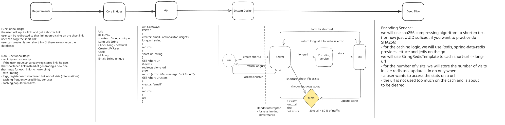
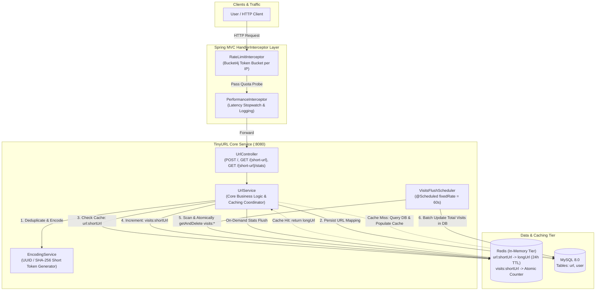
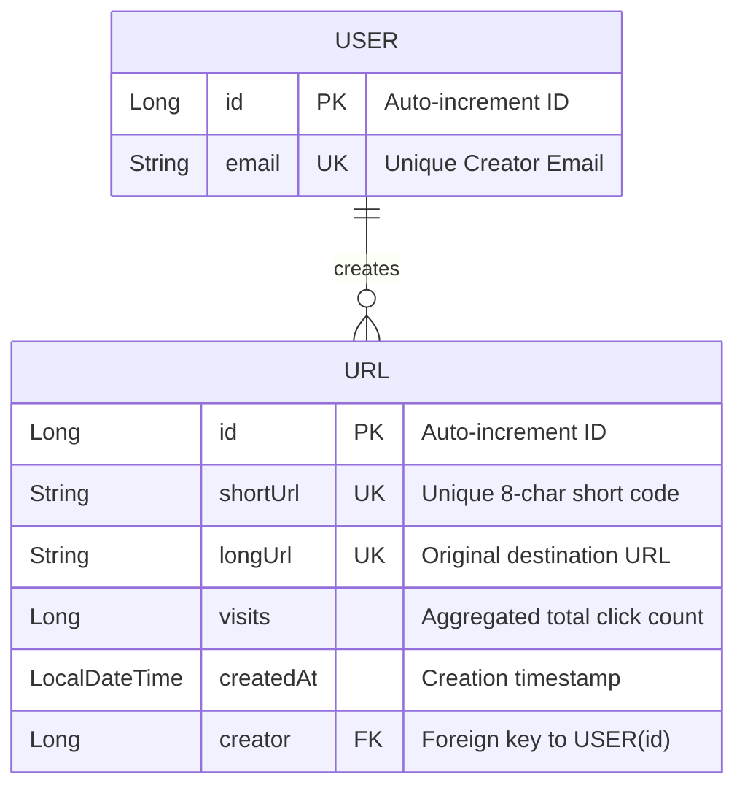
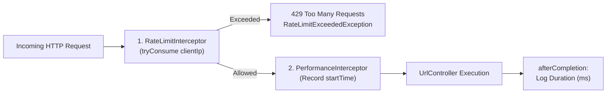
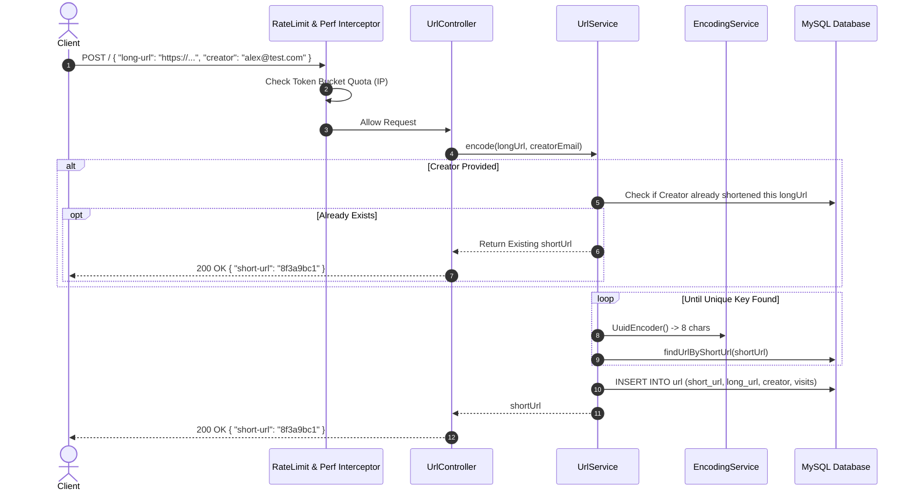
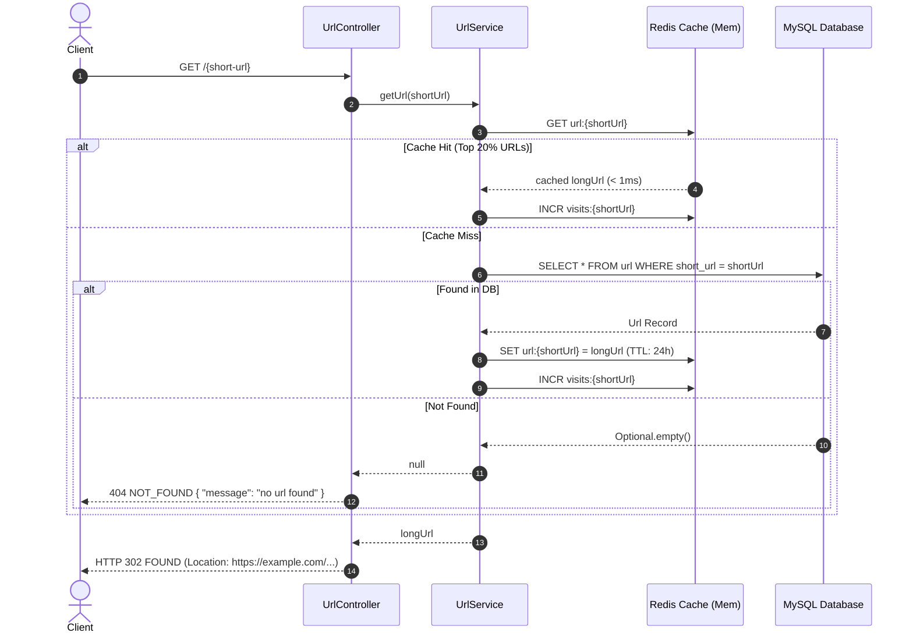
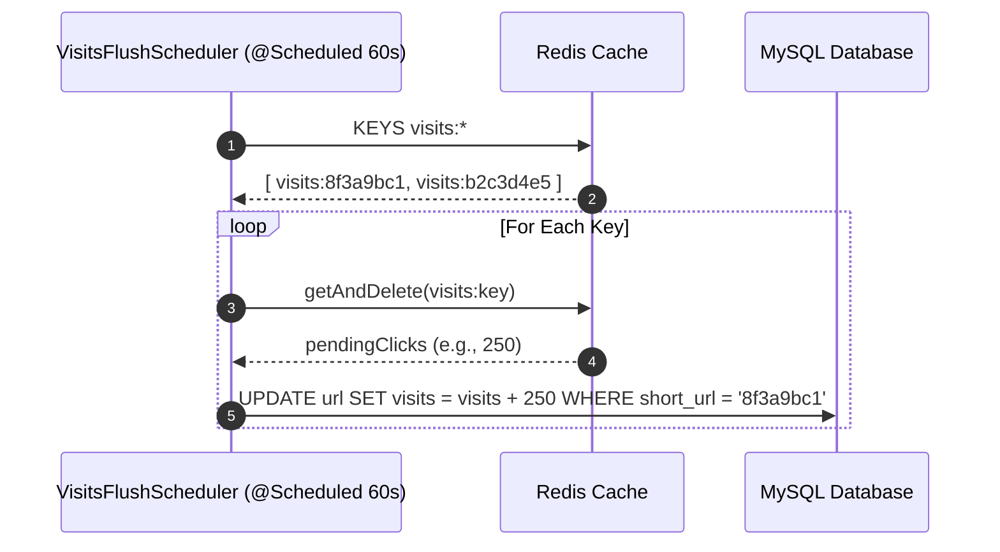

# 🔗 Distributed Scalable TinyURL System

[](https://openjdk.org/)
[](https://spring.io/projects/spring-boot)
[](https://www.mysql.com/)
[](https://redis.io/)
[](https://bucket4j.com/)
[](https://opensource.org/licenses/MIT)

A high-performance, production-ready distributed **TinyURL system design** implementation built with **Spring Boot 4**, **MySQL**, and **Redis**.

Engineered for ultra-low redirection latency, this system implements **read-through Redis caching** (leveraging the Pareto 80/20 rule), **decoupled write-behind analytics** to prevent database contention during viral traffic spikes, **Bucket4j token-bucket IP rate limiting**, and **idempotent creator link deduplication**.

---

## 📑 Table of Contents

- [System Architecture & Excalidraw Design](#-system-architecture--excalidraw-design)
- [Requirements (Functional & Non-Functional)](#-requirements)
- [Core Entities & Data Models](#-core-entities--data-models)
- [Key Architectural Highlights & Patterns](#-key-architectural-highlights--patterns)
  - [1. Two-Tier HandlerInterceptor Pipeline](#1-two-tier-handlerinterceptor-pipeline)
  - [2. Sub-Millisecond Redirection with Read-Through Redis Caching](#2-sub-millisecond-redirection-with-read-through-redis-caching)
  - [3. Write-Behind Atomic Visit Tracking](#3-write-behind-atomic-visit-tracking)
  - [4. Idempotent Creator URL Deduplication](#4-idempotent-creator-url-deduplication)
  - [5. Collision-Resistant Encoding Service](#5-collision-resistant-encoding-service)
- [Sequence Lifecycles](#-sequence-lifecycles)
  - [URL Shortening Flow](#url-shortening-lifecycle)
  - [URL Redirection Flow](#url-redirection-lifecycle)
  - [Scheduled Write-Behind Flush Flow](#scheduled-write-behind-flush-lifecycle)
- [Repository Structure](#-repository-structure)
- [Technology Stack](#-technology-stack)
- [Configuration & Environment Properties](#-configuration--environment-properties)
- [Getting Started](#-getting-started)
- [API Reference & Usage Examples](#-api-reference--usage-examples)
- [Error Handling & Status Codes](#-error-handling--status-codes)
- [Architecture Diagrams & Excalidraw Assets](#-architecture-diagrams--excalidraw-assets)

---

## 🏛 System Architecture & Excalidraw Design

Below is the complete system design matching the architectural blueprint in [docs/diagrams/tinyurl-system-design.svg](docs/diagrams/tinyurl-system-design.svg) and [docs/diagrams/tinyurl-system-design.excalidraw](docs/diagrams/tinyurl-system-design.excalidraw):

<p align="center">
  
</p>

### Interactive Component Flowchart (Mermaid)



---

## 📋 Requirements

### Functional Requirements
1. **URL Shortening**: Users input any valid HTTP/HTTPS URL and receive an 8-character shortened URL.
2. **Instant Redirection**: Accessing `GET /{short-url}` immediately issues an **HTTP 302 Found** redirect to the original long URL.
3. **Idempotent Link Deduplication**: If an authenticated creator submits an already registered long URL, the service returns the existing short link instead of creating duplicate records.
4. **Usage Statistics**: Creators can retrieve metadata, registration timestamps, and aggregated visit counts via `GET /{short-url}/stats`.

### Non-Functional Requirements
1. **Low-Latency Redirection**: Sub-millisecond response times for hot links utilizing Redis in-memory storage.
2. **High Availability & Atomicity**: Atomic counter increments in Redis to prevent race conditions during high concurrent traffic spikes.
3. **Zero Database Lock Contention**: Clicks are not written directly to MySQL per request; they are tracked in Redis and persisted via write-behind batch jobs.
4. **Rate Limiting**: Protects against automated scraping and abuse using token-bucket rate limiting (Bucket4j).
5. **Pareto Principle (80/20 Rule)**: 20% of short links account for 80% of all redirection requests. These top links remain in memory with a rolling 24-hour TTL.

---

## 🗄 Core Entities & Data Models



### Table Schema Breakdown:
- **`user`**:
  - `id`: Primary Key (AUTO_INCREMENT).
  - `email`: Creator identifier (Unique, Indexed).
- **`url`**:
  - `id`: Primary Key (AUTO_INCREMENT).
  - `short_url`: The unique 8-character token (Unique, Indexed for instant lookups).
  - `long_url`: The target destination URL (Unique).
  - `creator`: Foreign Key linking to `user(id)` (Nullable for anonymous pastes).
  - `created_at`: Auto-populated Hibernate `@CreationTimestamp`.
  - `visits`: Total lifetime redirects (Persisted from Redis batches).

---

## 🚀 Key Architectural Highlights & Patterns

### 1. Two-Tier HandlerInterceptor Pipeline
All incoming HTTP requests pass through an ordered Spring `HandlerInterceptor` chain configured in `WebConfig`:



- **`RateLimitInterceptor`**:
  - Extracts the real client IP, inspecting `X-Forwarded-For` for proxies or falling back to `RemoteAddr`.
  - Probes a `Bucket4j` token bucket (5 tokens capacity, 10-second refill interval).
  - Throws `RateLimitExceededException` (HTTP 429) if exhausted.
- **`PerformanceInterceptor`**:
  - Attaches `startTime` in `preHandle` and computes total duration in `afterCompletion`.
  - Emits structured execution logs (e.g., `the request GET:/8f3a9bc1 took: 2ms`).

---

### 2. Sub-Millisecond Redirection with Read-Through Redis Caching
To adhere to the **Pareto Principle (80/20 Rule)** where a small subset of URLs drives the overwhelming majority of traffic:
1. When `GET /{short-url}` is called, `UrlService` queries Redis key `url:{shortUrl}`.
2. **Cache Hit**: Returns `longUrl` directly from Redis in **< 1ms**.
3. **Cache Miss**: Queries MySQL, caches the result in Redis with a **24-hour expiration** (`Duration.ofDays(1)`), and returns the redirect.
4. **404 Handling**: If not found in cache or DB, throws `UrlNotFoundException` (HTTP 404).

---

### 3. Write-Behind Atomic Visit Tracking
Writing click counts directly to a relational database on every redirect causes row-level write contention and locks under heavy traffic. TinyURL solves this with a **Write-Behind Pattern**:
1. During redirection, Redis atomically increments:
   ```text
   INCR visits:{shortUrl}
   ```
2. **Scheduled Reconciliation (`VisitsFlushScheduler`)**:
   - Runs every 60 seconds (`@Scheduled(fixedRate = 60000)`).
   - Scans `visits:*` keys in Redis.
   - Atomically retrieves and resets the counter using `getAndDelete(key)`.
   - Performs a single batched update to MySQL:
     ```sql
     UPDATE url SET visits = visits + :pendingVisits WHERE short_url = :shortUrl;
     ```
3. **On-Demand Stats Synchronization (`findUrl`)**:
   - When a creator queries `/api/{short-url}/stats`, any pending visits currently buffered in Redis are immediately flushed into MySQL using `getAndDelete` before returning the latest totals.

---

### 4. Idempotent Creator URL Deduplication
When an authenticated creator submits an existing long URL:
- `UrlService.encode` checks if the creator already has an entry for `longUrl`.
- If found, it returns the existing `shortUrl` immediately, ensuring zero database pollution and consistent metrics per user.

---

### 5. Collision-Resistant Encoding Service
- Generates 8-character cryptographic tokens.
- Handles collision avoidance:
  ```java
  String shortUrl = encodingService.UuidEncoder();
  while (urlRepository.findUrlByShortUrl(shortUrl).isPresent()) {
      shortUrl = encodingService.UuidEncoder();
  }
  ```

---

## 🔄 Sequence Lifecycles

### URL Shortening Lifecycle



---

### URL Redirection Lifecycle



---

### Scheduled Write-Behind Flush Lifecycle



---

## 📂 Repository Structure

```text
TinyUrl/
├── pom.xml                                    # Spring Boot 4.1.1 + Redis + MySQL + Bucket4j
├── mvnw / mvnw.cmd                            # Maven Wrapper scripts
├── docs/
│   └── diagrams/
│       ├── tinyurl-system-design.svg          # Standalone SVG System Architecture
│       └── tinyurl-system-design.excalidraw   # Native editable Excalidraw JSON file
└── src/
    ├── main/
    │   ├── java/com/example/tinyurl/
    │   │   ├── contoller/
    │   │   │   ├── PerformanceInterceptor.java# Latency tracking HandlerInterceptor
    │   │   │   ├── RateLimitInterceptor.java  # Bucket4j token bucket HandlerInterceptor
    │   │   │   ├── UrlController.java         # REST endpoints (POST /, GET /{short-url}, stats)
    │   │   │   └── WebConfig.java             # Interceptor registration
    │   │   ├── entity/
    │   │   │   ├── Url.java                   # JPA entity (shortUrl, longUrl, visits, creator)
    │   │   │   └── User.java                  # JPA entity (email, urls)
    │   │   ├── exceptions/
    │   │   │   ├── ControllerExceptionsHandler.java # Centralized @ControllerAdvice handler
    │   │   │   ├── RateLimitExceededException.java  # HTTP 429
    │   │   │   └── UrlNotFoundException.java        # HTTP 404
    │   │   ├── Repository/
    │   │   │   ├── UrlRepository.java         # Spring Data JPA Url repository
    │   │   │   └── UserRepository.java        # Spring Data JPA User repository
    │   │   ├── service/
    │   │   │   ├── EncodingService.java       # UUID / SHA-256 token compressor
    │   │   │   ├── RateLimiterService.java    # Bucket4j in-memory token manager
    │   │   │   ├── UrlService.java            # Shortening, cache-aside & visit coordinator
    │   │   │   └── VisitsFlushScheduler.java  # 60-second write-behind scheduled task
    │   │   └── TinyUrlApplication.java        # Main Spring Boot entrypoint (@EnableScheduling)
    │   └── resources/
    │       └── application.properties         # Server port, datasource, Redis & rate-limit properties
    └── test/
```

---

## 🛠 Technology Stack

| Component | Technology | Role |
|---|---|---|
| **Core Framework** | Java 17, Spring Boot 4.1.1 | Robust enterprise application core |
| **Relational Storage** | MySQL 8.0, Spring Data JPA | Persistent storage of short links, creators, and clicks |
| **In-Memory Cache & Counters**| Redis (Lettuce), `StringRedisTemplate` | Sub-millisecond URL caching & atomic visit counters |
| **Rate Limiting** | Bucket4j Core (8.10.1) | Token-bucket IP rate limiter in `HandlerInterceptor` |
| **Scheduling** | Spring `@EnableScheduling` | 60s asynchronous write-behind batch flusher |
| **Build System** | Apache Maven, Lombok | Dependency management & boilerplate elimination |

---

## ⚙ Configuration & Environment Properties

Located in `src/main/resources/application.properties`:

```properties
spring.application.name=TinyUrl
server.port=8080

# Database
spring.datasource.url=jdbc:mysql://localhost:3306/tinyurl?createDatabaseIfNotExist=true
spring.datasource.username=root
spring.datasource.password=root
spring.jpa.hibernate.ddl-auto=update
spring.jpa.database=mysql

# Redis In-Memory Tier
spring.data.redis.host=localhost
spring.data.redis.port=6379

# Bucket4j Rate Limiting Configuration
app.ratelimit.capacity=5
app.ratelimit.refill-in-seconds=10
```

---

## 🚦 Getting Started

### Prerequisites
- **JDK 17+** installed
- **MySQL 8.0** running on `localhost:3306`
- **Redis** running on `localhost:6379`

> 💡 *Quickly spin up MySQL and Redis using Docker:*
```bash
docker run -d --name tinyurl-mysql -p 3306:3306 -e MYSQL_ROOT_PASSWORD=root mysql:8.0
docker run -d --name tinyurl-redis -p 6379:6379 redis:alpine
```

### Run the Application

Using the Maven wrapper:

**On Linux / macOS:**
```bash
./mvnw clean spring-boot:run
```

**On Windows:**
```powershell
.\mvnw.cmd clean spring-boot:run
```

The application will start on port `8080`.

---

## 📡 API Reference & Usage Examples

### 1. Shorten a URL (`POST /`)

#### Anonymous Request:
```bash
curl -X POST http://localhost:8080/ \
  -H "Content-Type: application/json" \
  -d '{
    "long-url": "https://docs.spring.io/spring-boot/docs/current/reference/html/"
  }'
```

*Response (200 OK):*
```json
{
  "short-url": "3a8f1b2c"
}
```

#### With Creator Attribution:
```bash
curl -X POST http://localhost:8080/ \
  -H "Content-Type: application/json" \
  -d '{
    "creator": "developer@example.com",
    "long-url": "https://github.com/spring-projects/spring-boot"
  }'
```

---

### 2. Follow Short URL (`GET /{short-url}`)

```bash
curl -i -X GET http://localhost:8080/3a8f1b2c
```

*Response (302 Found):*
```http
HTTP/1.1 302 Found
Location: https://docs.spring.io/spring-boot/docs/current/reference/html/
```

---

### 3. Retrieve URL Statistics (`GET /{short-url}/stats`)

```bash
curl -X GET http://localhost:8080/3a8f1b2c/stats \
  -H "Content-Type: application/json" \
  -d '{
    "email": "developer@example.com"
  }'
```

*Response (200 OK):*
```json
{
  "id": 1,
  "shortUrl": "3a8f1b2c",
  "longUrl": "https://github.com/spring-projects/spring-boot",
  "visits": 1420,
  "createdAt": "2026-10-15T11:40:00"
}
```

---

## 🛡 Error Handling & Status Codes

Managed centrally via `@ControllerAdvice` in `ControllerExceptionsHandler`:

| HTTP Status | Exception Class | Reason |
|---|---|---|
| **400 Bad Request** | `IllegalArgumentException` | `long-url` parameter missing in request body |
| **404 Not Found** | `UrlNotFoundException` | Short URL does not exist in cache or database |
| **429 Too Many Requests** | `RateLimitExceededException` | Rate limit quota exceeded (Bucket4j token exhausted) |

---

## 🎨 Architecture Diagrams & Excalidraw Assets

<p align="center">
  
</p>

- **High-Resolution Architecture SVG:** [docs/diagrams/tinyurl-system-design.svg](docs/diagrams/tinyurl-system-design.svg)
- **Editable Excalidraw Scene File:** [docs/diagrams/tinyurl-system-design.excalidraw](docs/diagrams/tinyurl-system-design.excalidraw)

To edit or customize:
1. Open [excalidraw.com](https://excalidraw.com).
2. Drag and drop `docs/diagrams/tinyurl-system-design.excalidraw` directly onto the canvas.

---

## 📄 License

This project is licensed under the MIT License - feel free to use and adapt for learning, system design interviews, or production deployments.
